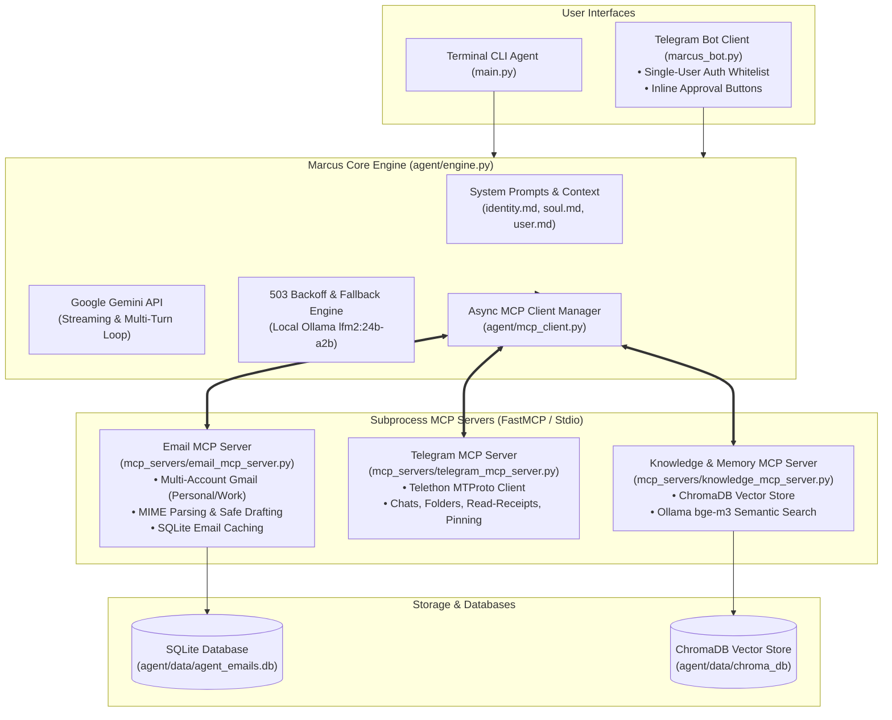

# Marcus: Autonomous AI Executive Assistant

[](https://www.python.org/)
[](https://modelcontextprotocol.io/)
[](https://aistudio.google.com/)
[](LICENSE)

Marcus is a fully autonomous, persona-driven **AI Executive Assistant** built on modern **Model Context Protocol (MCP)** multi-server architecture. Designed to eliminate daily communication and organizational overhead, Marcus manages multi-account Gmail inboxes, automates Telegram messaging and channel organization, and leverages local SQL and Vector databases for long-term semantic memory.

Unlike naive chatbot wrappers, Marcus features an asynchronous, streaming multi-turn tool execution loop with strict **Human-in-the-Loop (HITL)** safeguards for destructive and outbound actions.

---

## Architecture Overview



---

## Key Capabilities

### 1. Model Context Protocol (MCP) Multi-Server Isolation
- **Process Isolation**: Tools run as isolated background stdio subprocesses adhering to the Anthropic Model Context Protocol specification.
- **Dynamic Discovery**: The core engine queries and aggregates tools at boot without hardcoded coupling.
- **Fail-Safe Startup**: If a specific server (e.g., Telegram) is unconfigured, Marcus logs a warning and continues running with available servers.

### 2. Multi-Account Gmail Integration
- **Personal & Work Support**: Manages multiple independent OAuth2 tokens (`token_personal.json`, `token_work.json`).
- **Safe Drafting Protocol**: Strictly enforces a draft-first rule (`create_draft`, `create_response_draft`, `forward_email`). Marcus is programmatically prevented from sending emails without explicit approval.
- **Local Relational Caching**: Automatically persists email headers, bodies, and attachment metadata into SQLite via SQLAlchemy for instant local search.

### 3. Telegram Automation (User MTProto & Bot UI)
- **MTProto User Automation**: Powered by Telethon to manage folders/dialog filters, unread badge clearing, channel creation, and pinned chats.
- **Decoupled Bot Interface (`marcus_bot.py`)**: A dedicated Telegram Bot interface built on `aiogram 3.x` with:
  - **Single-User Whitelist**: Rejects requests from unauthorized user IDs for complete security.
  - **Interactive Inline Keyboard Approvals**: Sends interactive `✅ Approve` / `❌ Deny` prompts to your phone before executing sensitive actions (sending messages, trashing threads).

### 4. Hybrid Long-Term Memory
- **Structured Search**: Query email metadata, date ranges, senders, and attachment presence with SQLAlchemy.
- **Semantic Vector Memory**: Uses ChromaDB and Ollama (`bge-m3` embedding model) to save user preferences, contact details, and historical context across sessions.

### 5. Resilient AI Engine
- **Streaming Execution**: Real-time response streaming for fast user feedback.
- **Multi-Turn Tool Calling**: Autonomously chains tools (e.g., search -> retrieve -> draft -> summarize) in a single user query.
- **API Resilience**: Automatic exponential backoff for temporary Gemini 503 unavailability, accompanied by local Ollama fallback support.

---

## Project Structure

```shell
├── agent/
│   ├── data/
│   │   └── database_manager.py     # SQLite schema and email search queries
│   ├── engine.py                   # MarcusEngine: Gemini streaming, tool loops, fallback
│   └── mcp_client.py               # Async multi-server MCP client manager
├── context/
│   ├── identity.md                 # System instructions and operational constraints
│   ├── soul.md                     # Persona, tone, and brevity rules
│   ├── user.md.example             # Template for user profile and contact context
│   └── user.md                     # Personal user context (gitignored)
├── mcp_servers/
│   ├── email_mcp_server.py         # FastMCP server for Gmail multi-account operations
│   ├── telegram_mcp_server.py      # FastMCP server for Telegram MTProto automation
│   └── knowledge_mcp_server.py     # FastMCP server for ChromaDB vector memory
├── tools/
│   ├── knowledge_tools.py          # Vector memory class (used by agent engine and DB manager)
│   └── system_tools.py             # System utilities (datetime, clean exit)
├── .env.example                    # Template for required environment variables
├── .gitignore                      # Security exclusions (tokens, sessions, DBs)
├── main.py                         # CLI entry point
├── marcus_bot.py                   # Telegram Bot UI entry point
└── requirements.txt                # Python dependencies
```

---

## Modular Persona & Context Architecture (`context/`)

Marcus splits his system instructions into a decoupled **tripartite context engine** inside the `context/` directory. Rather than relying on a hardcoded monolithic prompt, Marcus dynamically stitches together three distinct markdown layers at boot time (`agent/engine.py`):

```text
context/
├── identity.md     # Role, operational constraints, MCP rules, and summarization templates
├── soul.md         # Personality, sarcastic tone, anti-fluff rules, and communication style
└── user.md         # Personal profile, contacts, and domain priorities (customizable)
```

Each layer can be adjusted independently without touching a single line of Python code:

### 1. `identity.md` — Operational Guardrails & Hardcoded Safety
Defines Marcus's executive responsibilities, MCP boundaries, and error recovery:
* **Hardcoded Runtime Approvals (No AI Hallucination Risk)**:
  * Marcus **does not rely on LLM self-restraint or prompt thinking** to avoid sending messages or deleting data.
  * Instead, outbound and destructive actions (`send_draft`, `send_message`, `edit_message`, `forward_email`, `unsubscribe_from_email`, `block_sender`, `forward_message`) are **hardcoded in the bot runtime** (`agent/engine.py` & `marcus_bot.py`).
  * Whenever Marcus calls one of these tools, the engine automatically halts execution and presents interactive `[✅ Approve]` and `[❌ Deny]` buttons in Telegram (or a `[y/N]` prompt in CLI). If denied, the tool call returns a denial error and Marcus asks what to do instead.
* **Autonomous Execution Rules (Prompt Directives)**:
  * **Contextual Parameter Resolution**: Instructed via prompt guardrails (`context/identity.md`) to retain and reuse identifiers (e.g., `email_id`, `chat_id`, `message_id`) from previous tool results in the conversation turns without repeatedly asking for technical IDs.
  * **Search Query Optimization**: Instructed to enrich email queries with negative filters (`-offers -marketing -newsletter`) to eliminate marketing noise during travel and ticket searches.
* **Output Formatting Templates**: Standardizes clean presentation for user review:
  * **[EMAIL DRAFT CREATED]**: Displays the drafted `To`, `Subject`, and full `Body` text so you can inspect emails before approving the send.
  * **[COMMUNICATION SUMMARIZATION]**: Clean thread digests categorized by `[GMAIL - RECEIVED]`, `[GMAIL - SENT]`, `[TELEGRAM - RECEIVED]`, and `[TELEGRAM - SENT]`.

### 2. `soul.md` — Personality & Tone of Voice
Defines Marcus's conversational flavor, attitude, and writing style:
* **Current Default Persona**: A sarcastic, slightly cynical assistant who reluctantly helps the user, but is lightning-fast and hyper-efficient. He hates wasting time with follow-up questions and gets straight to work.
* **Zero Corporate Fluff**: Strictly bans cliched corporate email fluff like *"I hope this email finds you well"* or *"I hope you are having a wonderful day."*
* **Grounding Rule**: Flags uncertainty for human review instead of guessing or simulating data.
* **How to Customize**: If you prefer a polite butler, a corporate formal assistant, or a cheerful coordinator, simply edit the `<personality>` and `<response_style>` tags in `context/soul.md` to instantly transform Marcus's voice.

### 3. `user.md` — Personal Profile & Priorities (Private & Fully Customizable)
* **What it Does**: Provides the background context Marcus needs to personalize communications: your name, location, roles, contact info, VIP contacts (family, team members), and preferred tone per platform.
* **Customization**: Copy `context/user.md.example` to `context/user.md` and customize it with your own details.
* **Privacy**: `context/user.md` is strictly `.gitignore`d, ensuring your personal background and private contacts never get committed to GitHub.

---

## Getting Started

### Prerequisites
- **Python 3.10+**
- **Ollama (Must be running locally)**: Required for vector memory embeddings (`bge-m3`) and offline LLM fallback (`lfm2:24b-a2b`). Ensure the Ollama daemon is active (`ollama serve`) and pull the required models:
  ```bash
  ollama pull bge-m3
  ollama pull lfm2:24b-a2b
  ```
- **Google AI Studio API Key**: For Gemini models.
- *(Optional)* **Google Cloud OAuth 2.0 Client Credentials**: Required for Gmail features.
- *(Optional)* **Telegram API ID & Hash**: Required for Telegram user-client tools.
- *(Optional)* **Telegram Bot Token**: Required for running the Telegram Bot client (`marcus_bot.py`).

---

### Step-by-Step Setup

#### 1. Clone the Repository & Create Virtual Environment
```bash
git clone https://github.com/TheTymur/MarcusAI.git
cd MarcusAI

python3 -m venv .venv
source .venv/bin/activate  # On Windows: .venv\Scripts\activate
```

#### 2. Install Dependencies
```bash
pip install -r requirements.txt
```

#### 3. Configure Environment Variables
Copy `.env.example` to `.env`:
```bash
cp .env.example .env
```
Open `.env` and insert your credentials:
```ini
# Required:
API_KEY_GEMINI=your_gemini_api_key_here

# Optional (for Telegram MCP tools):
API_TELEGRAM_ID=your_api_id
API_TELEGRAM_HASH=your_api_hash
TELEGRAM_SESSION_NAME=marcus_session

# Optional (for running marcus_bot.py):
TELEGRAM_BOT_TOKEN=your_bot_token_from_botfather
ALLOWED_TELEGRAM_USER_ID=your_numeric_telegram_id
```

#### 4. Configure Personal Context (Optional)
Marcus adapts his tone and knows your contacts using a localized context file:
```bash
cp context/user.md.example context/user.md
```
Edit `context/user.md` to describe your personal/work background and communication preferences. *(This file is strictly gitignored to keep personal data private).*

#### 5. Configure Gmail OAuth (Optional)
If using the Gmail MCP Server:
1. Go to the [Google Cloud Console](https://console.cloud.google.com/) and enable the **Gmail API**.
2. Create an **OAuth 2.0 Client ID** (Desktop Application) and download the JSON file.
3. Save it in the project root as `credentials.json`.
4. On first tool execution, a browser prompt will open to authorize access and create `token_personal.json` / `token_work.json`.

---

### Running Marcus

#### Option A: Terminal CLI Interface
Run the interactive CLI agent directly in your terminal:
```bash
python main.py
```

#### Option B: Telegram Bot Client (Remote Control)
Run the background Telegram bot to control Marcus from your phone with interactive approval buttons:
```bash
python marcus_bot.py
```

---

## Security & Privacy Notice (For Reviewers & Recruiters)

This repository represents an authentic, production-grade personal automation system tailored for daily productivity. For security and privacy:
- **No Credentials Committed**: All OAuth tokens (`token_*.json`), Telegram session files (`*.session`), Google Client Secrets (`credentials.json`), SQLite databases (`*.db`), and personal context profiles (`context/user.md`) are explicitly excluded via `.gitignore`.
- **Zero Hallucination Sending**: Outgoing emails and messages require explicit affirmative user confirmation or an interactive button click (`Approve`).
- **Single-User Telegram Whitelist**: The Telegram bot drops any incoming message whose sender ID does not match `ALLOWED_TELEGRAM_USER_ID`.

---

## License

This project is licensed under the [MIT License](LICENSE).
